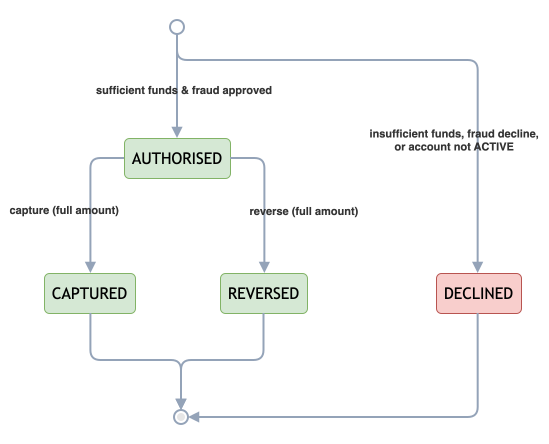
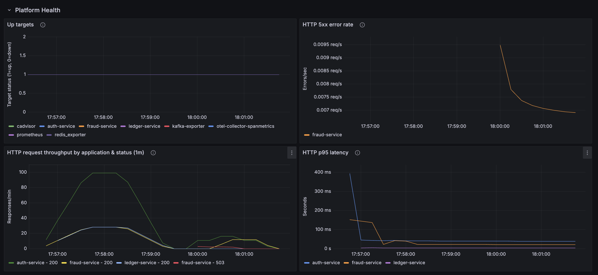
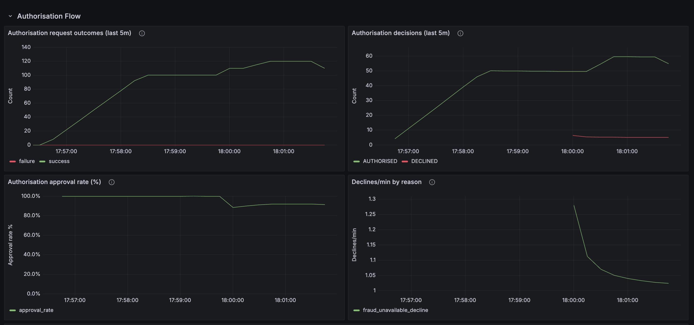
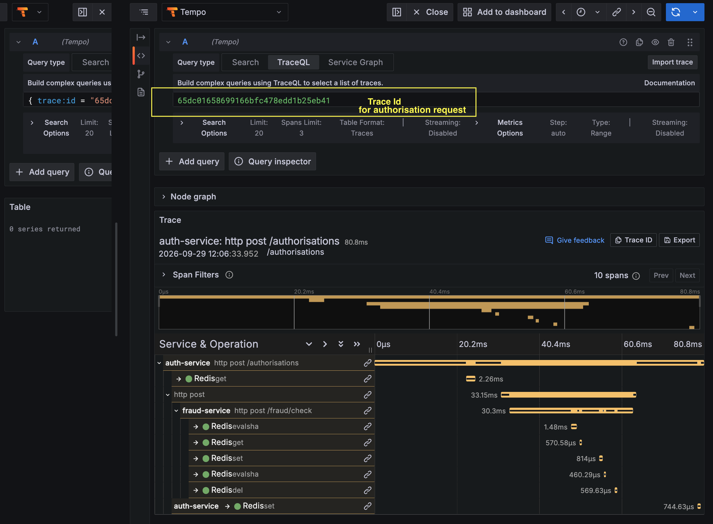
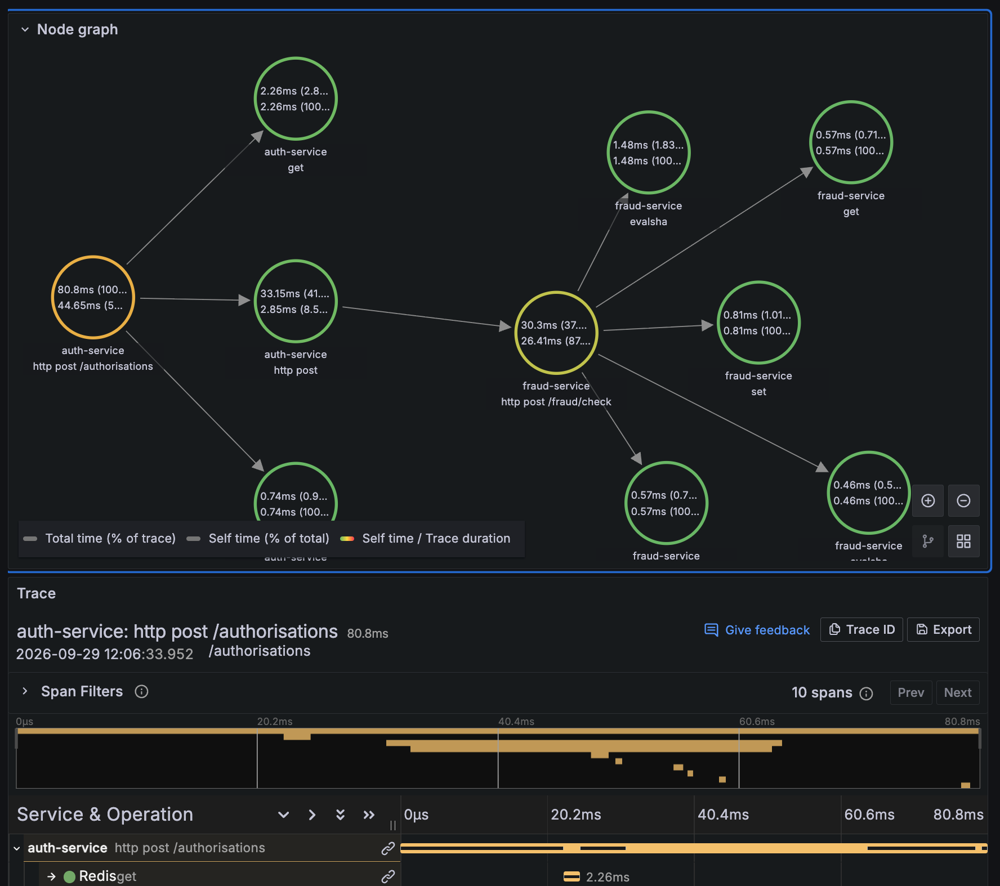
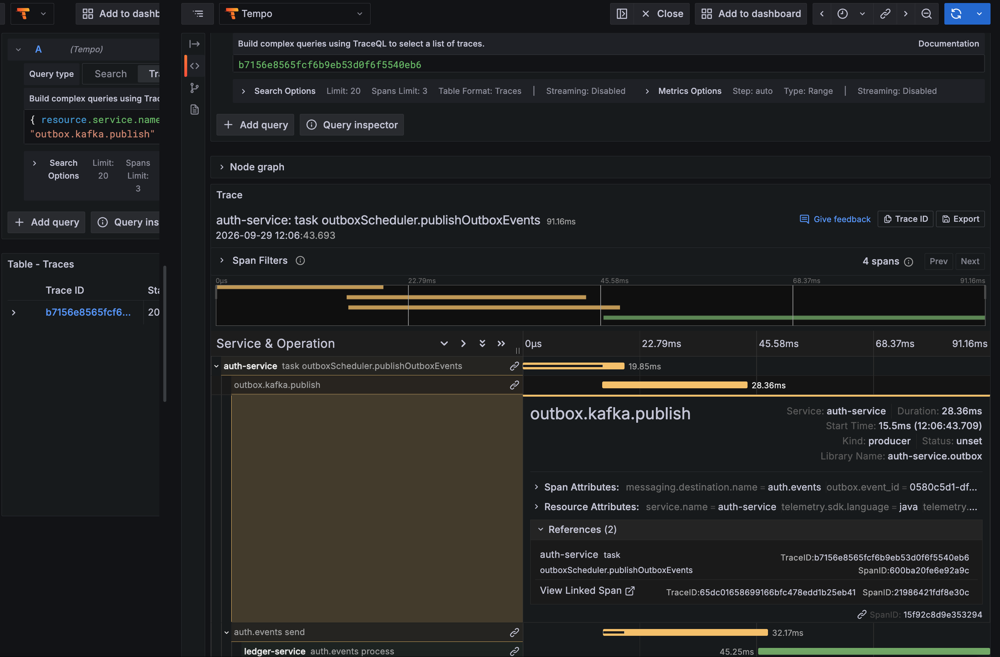
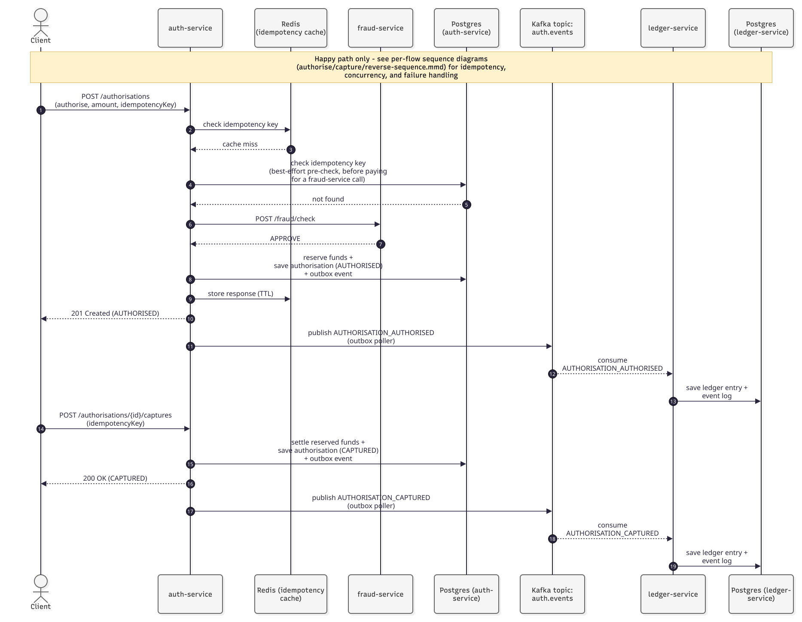
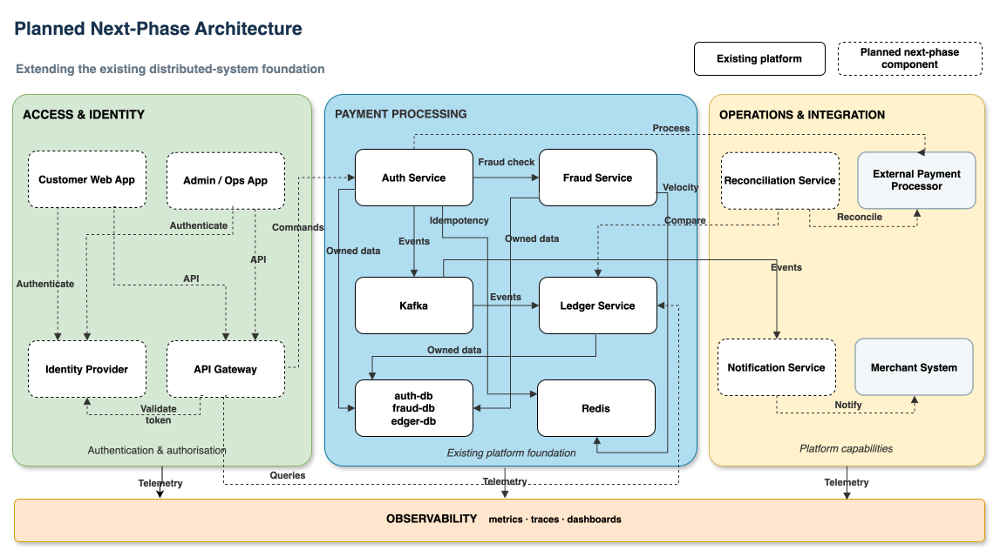

# Payment Platform

A distributed payment-processing project built around explicit service boundaries, reliable event
delivery, resilience, and end-to-end observability.

It implements authorise → capture → reverse payment flows across three Spring Boot services,
combining synchronous fraud evaluation with asynchronous ledger propagation through a transactional
outbox and Kafka.

The current implementation provides the working foundation described below. The
[roadmap](docs/roadmap.md) extends that foundation with identity and access management, an API
gateway, reconciliation, notifications, and user-facing applications.

[](https://github.com/ShirongQuan/payment-platform/actions/workflows/ci.yml)


## Table of Contents

- [What the Platform Implements](#what-the-platform-implements)
- [Architecture at a Glance](#architecture-at-a-glance)
- [Key Design Highlights](#key-design-highlights)
    - [Domain & Ledger](#domain--ledger)
    - [Eventing & Outbox](#eventing--outbox)
    - [Reliability](#reliability)
    - [Observability](#observability)
    - [API](#api)
    - [Security](#security)
    - [Engineering Practices](#engineering-practices)
- [Quick Start](#quick-start)
- [Demo Journey](#demo-journey)
- [Implementation Status & Roadmap](#implementation-status--roadmap)
- [Documentation Map](#documentation-map)

---

## What the Platform Implements

The platform is composed of three independently deployed Spring Boot services — **auth-service**,
**fraud-service**, and **ledger-service** — with explicit service and data-ownership boundaries.
Services coordinate synchronously over REST where an immediate decision is required and
asynchronously through Kafka where independent processing and eventual consistency are appropriate.

The current implementation includes:

- Payment lifecycle handling (authorise, full capture, full reverse) with a real, guarded state
  machine
- An event-sourced ledger projection with strict invariants (balance conservation, currency
  consistency, idempotent posting)
- Reliable event delivery via the outbox pattern and Kafka, including dead-letter handling
- Idempotency and concurrency control under race conditions (optimistic locking + idempotency-race
  recovery)
- Circuit breakers, timeouts, and fail-open policy for a synchronous downstream dependency
  (fraud-service)
- End-to-end observability with distributed tracing, metrics, dashboards, and correlated logs
- A shared cross-cutting library (`shared-spring-lib`) and an automated test suite backed by CI

## Architecture at a Glance

<p>
  <a href="https://raw.githubusercontent.com/ShirongQuan/payment-platform/main/docs/architecture/diagrams/containers.svg">
    
  </a>
</p>

*Figure 1: C4 Container diagram — auth-service, fraud-service, ledger-service, Kafka, Postgres,
Redis, and the observability stack.*

Each service owns its application data. Cross-service coordination happens through explicit APIs
and events rather than shared database access.

The architecture documentation follows a C4 model:

- **[System Context (L1)](docs/architecture/system-context.md)** — external actors and system boundary
- **[Containers (L2)](docs/architecture/containers.md)** — services, data stores, messaging
- **[Components (L3)](docs/architecture/components-auth-service.md)** — internals of `auth-service`
- **[Trust Boundaries](docs/architecture/trust-boundaries.md)** — security zones

## Key Design Highlights

### Domain & Ledger

- Event-sourced, single-entry ledger projection: each state-changing payment event (authorise,
  capture, reverse) produces a durable ledger entry, with balance conservation, currency consistency,
  and idempotent posting enforced as invariants
- Explicit authorisation/account state machines with guarded transitions (`AUTHORISED → CAPTURED`,
  `AUTHORISED → REVERSED`, terminal `DECLINED`; account `ACTIVE ⇄ LOCKED`)
- 📄 [Accounting Model](docs/domain/accounting-model.md) · [Payment State Machine](docs/domain/state-machine.md)

<p>
  <a href="https://raw.githubusercontent.com/ShirongQuan/payment-platform/main/docs/flows/diagrams/payment-lifecycle-state.svg">
    
  </a>
</p>

*Figure 2: Payment status transitions.*

### Eventing & Outbox

- Payment state changes and their corresponding outbox records are committed atomically in the
  same local database transaction, allowing events to be published reliably to Kafka without a
  distributed transaction
- Kafka topics keyed by the authorisation id for per-aggregate ordering
- At-least-once delivery; `ledger-service` deduplicates by `eventId` for effectively-once projection
- 📄 [Outbox Pattern](docs/eventing/outbox-pattern.md) · [Kafka Topics](docs/eventing/kafka-topics.md)

### Reliability

- Optimistic locking and idempotency-race recovery protect payment state transitions from
  concurrent duplicate operations
- Fraud evaluation is protected by a time limiter and circuit breaker, with a constrained fail-open
  policy for explicitly eligible requests
- Kafka consumers use retry and dead-letter handling so downstream processing failures remain
  isolated from the originating payment transaction
-

📄 [Concurrency & Consistency](docs/reliability/concurrency-consistency.md) · [Resilience Patterns](docs/reliability/resilience-patterns.md)

### Observability

- OpenTelemetry traces across auth → fraud → Kafka → ledger, with trace context propagated over
  both HTTP and Kafka headers
- Prometheus + Grafana dashboards for latency, error rate, outbox lag, DLT rate, and idempotency/
  concurrency-conflict counts; every log line carries `traceId`/`spanId`/`correlationId` for
  cross-referencing logs, traces, and metrics for the same request

📄 [Telemetry Guidelines](docs/observability/telemetry.md) · [Observability Runbook (Lightweight)](docs/observability/runbook.md)

**Grafana dashboard — platform health, authorisation flow**

<p>
  <a href="https://raw.githubusercontent.com/ShirongQuan/payment-platform/main/docs/observability/screenshots/dashboard/platform-health.png">
    
  </a>
</p>
<p>
  <a href="https://raw.githubusercontent.com/ShirongQuan/payment-platform/main/docs/observability/screenshots/dashboard/authorisation-flow.png">
    
  </a>
</p>

*Figure 3: Grafana dashboard — platform health, authorisation flow.*

**Authorisation trace**

<p>
  <a href="https://raw.githubusercontent.com/ShirongQuan/payment-platform/main/docs/observability/screenshots/trace/auth-trace-e567d636-51fe-414a-938e-93d675f23094.png">
    
  </a>
</p>

**Node graph**

<p>
  <a href="https://raw.githubusercontent.com/ShirongQuan/payment-platform/main/docs/observability/screenshots/trace/node-graph-e567d636-51fe-414a-938e-93d675f23094.png">
    
  </a>
</p>

**Outbox event trace links to the same authorisation trace**

<p>
  <a href="https://raw.githubusercontent.com/ShirongQuan/payment-platform/main/docs/observability/screenshots/trace/outbox-trace-e567d636-51fe-414a-938e-93d675f23094.png">
    
  </a>
</p>

*Figure 4: Distributed trace of an authorize request across services (Tempo) — span waterfall and
node graph, both for the same `correlationId`. The full request → log → trace → metric walkthrough,
including the linked outbox trace, is in
[Telemetry Guidelines § Correlating Logs, Metrics, and Traces](docs/observability/telemetry.md#6-correlating-logs-metrics-and-traces).*

### API

- Consistent RFC 7807 error model across services, with a service-specific `errorCode`
- `idempotencyKey` request-body semantics for safe retries on every payment-critical endpoint
- 📄 [API docs](docs/api/README.md) (overview, idempotency) · [OpenAPI specs](docs/api/README.md#openapi-specs)

### Security

- Threat model covers the platform's trust boundaries and abuse vectors, clearly separating what's
  implemented today from what's planned next
- Data-protection posture (PII handling, masking) and audit/compliance intent documented up front

📄 [Threat Model](docs/security/threat-model.md) · [Data Protection](docs/security/data-protection.md) · [Audit & Compliance](docs/security/audit-compliance.md)

### Engineering Practices

- `shared-spring-lib` centralizes cross-cutting concerns (correlation ids, RFC 7807 error model,
  idempotency hashing) so all three services stay consistent without copy-paste
- Unit + integration tests (Testcontainers-backed) run in every module, wired into GitHub Actions CI
- Scripted traffic generation (`load-tests/`) provides repeatable testing and demonstration of
  idempotency replay, circuit-breaker transitions, DLT routing, and concurrency conflicts
- Every architecture/consistency decision is recorded as a numbered ADR

📄 [Development Guide](docs/getting-started/development.md) · [Testing Strategy](docs/testing/strategy.md) · [load-tests/](load-tests/README.md) · [Architecture Decision Records (ADR) Index](docs/decisions/README.md)

## Quick Start

Run the full platform with pre-published images:

```bash
docker compose -f infra/docker/docker-compose.yml -f infra/docker/docker-compose.app.yml up -d
```

Check that all services are healthy:

```bash
docker compose -f infra/docker/docker-compose.yml -f infra/docker/docker-compose.app.yml ps
```

➡️ Full setup options (pre-published images, local builds, IDE run), prerequisites, and
troubleshooting are in the **[Getting Started guide](docs/getting-started/README.md)**.

For Docker Compose services, ports, health checks, logs, and environment reset instructions, see
the **[Infrastructure Guide](infra/README.md)**.

## Demo Journey

Follow a guided walkthrough — authorize a payment, capture it, observe the ledger update, and
trace the request across services:

➡️ **[Demo Guide](docs/getting-started/demo-guide.md)**

Preview of what you'll see:

<p>
  <a href="https://raw.githubusercontent.com/ShirongQuan/payment-platform/main/docs/flows/diagrams/payment-lifecycle-happy-path.svg">
    
  </a>
</p>

*Figure 5: Authorize → Capture → Ledger posting → Event publish (happy path; see
[Payment Lifecycle](docs/flows/payment-lifecycle.md) for the full per-endpoint sequence diagrams
covering idempotency, concurrency, and failure handling).*

## Implementation Status & Roadmap

The current codebase provides the distributed-system foundation used throughout the project. The
next phase builds on that foundation with additional access, operational, and payment capabilities.

### Implemented foundation

| Area                                                         | Details                                                                  |
|--------------------------------------------------------------|--------------------------------------------------------------------------|
| Core payment flow (authorise/capture/reverse)                | [Payment State Machine](docs/domain/state-machine.md)                    |
| Event-driven ledger (outbox + Kafka + DLT)                   | [Outbox Pattern](docs/eventing/outbox-pattern.md)                        |
| Idempotency & concurrency control                            | [Concurrency & Consistency](docs/reliability/concurrency-consistency.md) |
| Resilience (circuit breaker, fail-open, retries)             | [Resilience Patterns](docs/reliability/resilience-patterns.md)           |
| Observability (traces, metrics, dashboards, correlated logs) | [Telemetry Guidelines](docs/observability/telemetry.md)                  |
| Automated tests + CI build                                   | [Testing Strategy](docs/testing/strategy.md)                             |
| Repeatable traffic and failure scenarios                     | [load-tests/](load-tests/README.md)                                      |

### Planned next phase

| Area                                     | Roadmap                                                        |
|------------------------------------------|----------------------------------------------------------------|
| Identity, authentication & authorisation | [Roadmap next steps](docs/roadmap.md#5-next-steps-prioritized) |
| API gateway & infrastructure rate limits | [Roadmap next steps](docs/roadmap.md#5-next-steps-prioritized) |
| Reconciliation service                   | [Roadmap next steps](docs/roadmap.md#5-next-steps-prioritized) |
| Customer and admin applications          | [Roadmap next steps](docs/roadmap.md#5-next-steps-prioritized) |
| Notification service                     | [Roadmap next steps](docs/roadmap.md#5-next-steps-prioritized) |
| Broader payment lifecycle capabilities   | [Roadmap](docs/roadmap.md)                                     |

Full detail, rationale, and prioritization live in the [project roadmap](docs/roadmap.md).

## Planned Next-Phase Architecture

The next phase extends the existing distributed-system foundation with access and identity
capabilities, reconciliation, notifications, external processor integration, and user-facing
applications.

The diagram below provides a simplified view of that planned evolution. It distinguishes the
existing platform foundation from planned next-phase components.

<p>
  <a href="https://raw.githubusercontent.com/ShirongQuan/payment-platform/main/docs/architecture/diagrams/next_phase_architecture.svg">
    
  </a>
</p>

*Figure 6: Planned next-phase architecture — extending the existing distributed-system foundation.*

For the full container-level view, see
the <a href="https://raw.githubusercontent.com/ShirongQuan/payment-platform/main/docs/architecture/diagrams/containers-next-phase.svg">
detailed C4 next-phase container diagram</a>, and
**[Containers — Next Phase](docs/architecture/containers.md#next-phase-planned)**.
  
- **API Gateway** — single ingress for routing, authN/authZ scope enforcement, and infra-level rate limiting
  in front of `auth-service`/`ledger-service`
- **Identity Provider (OIDC)** — centralized authn/authz issuing customer- vs. admin-scoped tokens, validated
  by the gateway and `auth-service`
- **Customer Web App / Admin Operations App** — planned user-facing applications authenticating
  through the identity provider and accessing platform APIs through the gateway
- **reconciliation-service** — scheduled job cross-checking ledger projections against account state (and
  eventually an external processor) to detect and flag drift
- **notification-service** — consumes `auth.events` to deliver email/SMS/webhook notifications on payment
  lifecycle changes
- **External Payment Processor / Card Network (simulated)** — settlement target for authorise/capture and
  source of truth for reconciliation
- **Config/Secrets Store** and **Object Storage** — supporting infra for secrets management and
  receipt/statement storage

➡️ Full detail and rationale: [Containers § Next Phase](docs/architecture/containers.md#next-phase-planned) ·
[Roadmap § Next Steps](docs/roadmap.md#5-next-steps-prioritized)

---

## Documentation Map

| Area                                                        | Link                                                             |
|-------------------------------------------------------------|------------------------------------------------------------------|
| Getting started, demo, development                          | [docs/getting-started/](docs/getting-started/README.md)          |
| Infrastructure (Docker Compose, ports, observability stack) | [Infrastructure](infra/README.md)                                |
| Architecture (C4 L1–L3, trust boundaries)                   | [docs/architecture/](docs/architecture/README.md)                |
| Payment flows & failure scenarios                           | [docs/flows/](docs/flows/README.md)                              |
| Domain rules (ledger, state machine)                        | [docs/domain/](docs/domain/accounting-model.md)                  |
| Data model (ERD, schema)                                    | [docs/data/](docs/data/data-model.md)                            |
| Eventing (outbox, Kafka)                                    | [docs/eventing/](docs/eventing/outbox-pattern.md)                |
| Reliability (concurrency, resilience)                       | [docs/reliability/](docs/reliability/concurrency-consistency.md) |
| Observability (telemetry, alerts, runbook)                  | [docs/observability/](docs/observability/README.md)              |
| API contracts                                               | [docs/api/](docs/api/README.md)                                  |
| Security                                                    | [docs/security/](docs/security/threat-model.md)                  |
| Testing strategy                                            | [docs/testing/](docs/testing/strategy.md)                        |
| Load tests (how to run)                                     | [load-tests/](load-tests/README.md)                              |
| Load-testing methodology (why, scenarios, results)          | [Load Testing Report](docs/testing/load-testing.md)              |
| Architecture Decision Records                               | [docs/decisions/](docs/decisions/README.md)                      |
| Roadmap (current status and planned evolution)              | [Project Roadmap](docs/roadmap.md)                               |

---

Personal engineering project by Shirong Quan.

