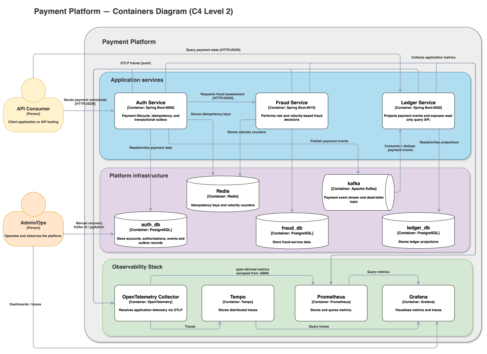

# Architecture Docs Index

C4-style architecture documentation for the Payment Platform, describing the distributed system from its
external boundary through service-level and component-level design.

The documentation follows the C4 zoom levels: **System Context (L1)** establishes the platform boundary,
**Containers (L2)** describes the distributed service and infrastructure architecture, and
**Components (L3)** shows how `auth-service` implements its local consistency and cross-service coordination
responsibilities.

## Table of Contents

- [Diagrams (C4)](#diagrams-c4)
  - [System Context (L1)](#system-context-l1)
  - [Containers (L2)](#containers-l2)
  - [Components — auth-service (L3)](#components--auth-service-l3)
- [Security](#security)
  - [Trust Boundaries](#trust-boundaries)
- [Related](#related)

## Diagrams (C4)

### System Context (L1)

[System Context (L1)](./system-context.md) — defines the Payment Platform's system boundary, its external actors
(Customer/Client App and Admin/Ops), its payment-processing responsibilities, and the major interactions that
cross the boundary.

  

*Figure 1: System Context (C4 Level 1) — external actors/systems and the Payment Platform system boundary.
Click the diagram to open the full-size SVG.*

### Containers (L2)

[Containers (L2)](./containers.md) — expands the platform into its distributed runtime architecture:
`auth-service`, `fraud-service`, and `ledger-service`, their service-owned data, synchronous REST and asynchronous
Kafka interactions, platform infrastructure (Postgres, Redis, Kafka), and the supporting observability stack
(OTel Collector, Tempo, Prometheus, Grafana).

  

*Figure 2: Containers (C4 Level 2) — auth-service, fraud-service, ledger-service, platform infrastructure
(Postgres, Redis, Kafka), and the observability stack. Click the diagram to open the full-size SVG.*

### Components — auth-service (L3)

[Components — auth-service (L3)](./components-auth-service.md) — expands the state-owning `auth-service` into its
internal components and shows how the payment write path implements local transactional consistency, idempotency,
concurrency control, synchronous fraud coordination, transactional outbox persistence, asynchronous event
publication, and observability. It also includes a mini authorise happy-path sequence, a responsibility table,
and boundary notes covering transaction boundaries, idempotency/concurrency points, and external calls.

  

*Figure 3: Components — auth-service (C4 Level 3) — controllers, application services, domain, repositories,
outbox, and outbound clients. Click the diagram to open the full-size SVG.*

  

*Figure 4: Sequence — authorise happy path (mini) across `auth-service` components. Click the diagram to open
the full-size SVG.*

## Security

### Trust Boundaries

[Trust Boundaries](./trust-boundaries.md) — documents the trust boundaries crossed by public API traffic,
internal service communication, service-owned data, and asynchronous messaging. It identifies the controls
applied at each boundary and separates the current architecture from planned identity, access, transport, and
deployment-security evolution.

  

*Figure 5: Trust boundaries — public API, internal service, service-owned data, and asynchronous messaging
boundaries. Click the diagram to open the full-size SVG.*

## Related

- [Flow Diagrams](../flows/README.md) — end-to-end interaction sequences for payment lifecycle, idempotency, and
  asynchronous event flows.
- [Data Model](../data/data-model.md) — service-owned persistence models and table-level detail for each
  application service.
- [ADRs](../decisions/README.md) — architectural decision records capturing the rationale behind the major
  distributed-system design choices referenced throughout these documents.
