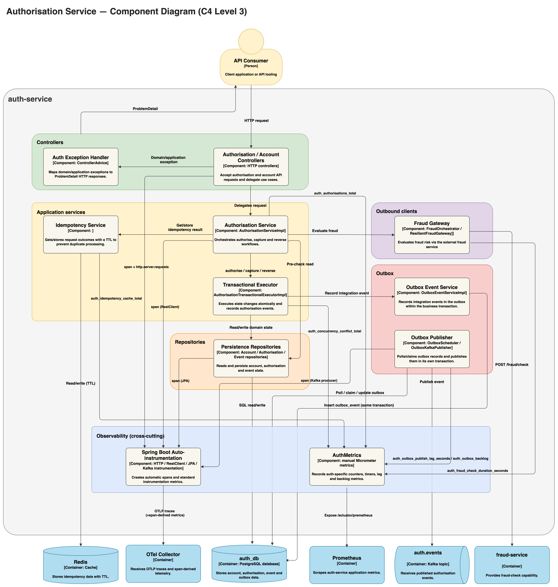
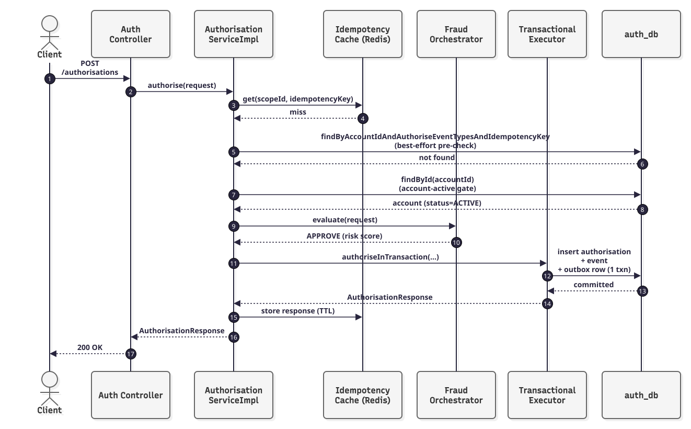

# Components — auth-service (C4 Level 3)

## Table of Contents

- [Diagram](#diagram)
    - [Component diagram](#component-diagram)
    - [Sequence: authorise happy path (mini)](#sequence-authorise-happy-path-mini)
- [Responsibility table](#responsibility-table)
- [Boundary notes](#boundary-notes)
    - [Transaction boundary](#transaction-boundary)
    - [Idempotency / concurrency points](#idempotency--concurrency-points)
    - [External calls](#external-calls)

## Diagram

This view expands the `auth-service` container from [Containers](./containers.md) and shows the components
responsible for the authorise/capture/reverse write paths.

`auth-service` owns the payment lifecycle and its transactional data boundary. It coordinates synchronously with
`fraud-service` when an immediate risk decision is required and asynchronously with downstream consumers through
the transactional outbox and Kafka. `fraud-service` and `ledger-service` therefore appear as external service
boundaries rather than internal components.

### Component diagram

Components are grouped into seven architectural responsibilities within `auth-service`: **controllers**,
**application services** (orchestrator + idempotency + the transactional executor), **domain** (entities),
**repositories**, **outbox**, **outbound clients**, and **observability** (cross-cutting instrumentation).

  

*Figure 3: Components — auth-service (C4 Level 3) — controllers, application services, domain, repositories,
outbox, and outbound clients. Click the diagram to open the full-size SVG.*

### Sequence: authorise happy path (mini)

  

*Figure 4: Sequence — authorise happy path (mini) across `auth-service` components. Click the diagram to open
the full-size SVG.*

## Responsibility table

| Component                                                                        | Category                                   | Responsibility                                                                                                                                                                                                                                                                                                                                                                                                                                                                                                                                                                                                                |
|----------------------------------------------------------------------------------|--------------------------------------------|-------------------------------------------------------------------------------------------------------------------------------------------------------------------------------------------------------------------------------------------------------------------------------------------------------------------------------------------------------------------------------------------------------------------------------------------------------------------------------------------------------------------------------------------------------------------------------------------------------------------------------|
| `AuthorisationController` / `AccountController`                                  | Controller                                 | Entry point. Request validation (bean validation), delegates to the application service, maps results to HTTP responses. No business logic.                                                                                                                                                                                                                                                                                                                                                                                                                                                                                   |
| `AuthExceptionHandler`                                                           | Controller                                 | Maps domain exceptions (`IdempotencyConflictException`, `AccountConcurrencyConflictException`, `AuthorisationIllegalStateException`, `AccountNotFoundException`, validation errors) to RFC 7807 `ProblemDetail` responses with stable HTTP status codes.                                                                                                                                                                                                                                                                                                                                                                      |
| `AuthorisationServiceImpl`                                                       | Application service                        | Orchestrates a single use case end-to-end: normalizes/validates input, checks the idempotency cache, performs an early DB idempotency pre-check, calls the fraud client, delegates the mutation to the transactional executor, and resolves any concurrency races that surface.                                                                                                                                                                                                                                                                                                                                               |
| `IdempotencyService`                                                             | Application service                        | Redis-backed fast path for previously computed responses, keyed `{operationType}:idempotency:{scopeId}:{idempotencyKey}`, configurable TTL (default 24h). Provides low-latency `get`/`store` operations while the database remains the durable idempotency boundary. See [ADR 0007: Idempotency store and key policy](../decisions/0007-idempotency-store-and-key-policy.md).                                                                                                                                                                                                                                                 |
| `AuthorisationTransactionalExecutorImpl`                                         | Application service (transaction boundary) | Defines the local transactional consistency boundary for payment mutations: the authoritative idempotency check-and-insert, account state mutation (`reserve`/`capture`/`reverse`), domain rows, and outbox record commit atomically within one `@Transactional` method. See [ADR 0005: Idempotency and Concurrency Rules for Authorisation Flows](../decisions/0005-idempotency-and-concurrency.md) / [ADR 0010: Database Concurrency Approach](../decisions/0010-database-concurrency-approach.md).                                                                                                                         |
| `FraudOrchestrator` / `ResilientFraudGateway`                                    | Outbound client                            | Calls `fraud-service` over HTTP, wrapped in a Resilience4j `@CircuitBreaker` + `@TimeLimiter` (250ms); falls back to an `unavailable` decision (tagged `TIMEOUT`/`CIRCUIT_OPEN`/etc.) instead of propagating failures. See [ADR 0008: Use Resilience4j for Circuit Breaker / Time Limiter (Fraud Gateway)](../decisions/0008-resilience4j-circuit-breaker-policy.md).                                                                                                                                                                                                                                                         |
| `AccountEntity` / `AuthorisationEntity` / `AuthorisationEventEntity`             | Domain                                     | JPA entities carrying the domain state and rules (`AccountEntity.reserve/capture/reverse`, `@Version` optimistic-locking columns, status enums). The transactional executor mutates these directly; nothing else does.                                                                                                                                                                                                                                                                                                                                                                                                        |
| `AccountRepository` / `AuthorisationRepository` / `AuthorisationEventRepository` | Repository                                 | Spring Data JPA repositories for current-state (`account`, `authorisation`) and append-only audit (`authorisation_event`) tables. `AuthorisationEventRepository` backs the idempotency uniqueness constraint (`account_id + event_type + idempotency_key`).                                                                                                                                                                                                                                                                                                                                                                   |
| `OutboxEventServiceImpl`                                                         | Outbox                                     | Called from *inside* the same local transaction as the domain mutation: builds the event payload map, captures the current W3C `traceparent` (via the OpenTelemetry API) onto the row, and inserts an `outbox_event` row (status `NEW`) via `OutboxEventRepository`. Committing the domain state change and outbox record atomically allows the event to be published reliably after the transaction without requiring a distributed transaction, while preserving the *original* request's trace context for asynchronous publication ([ADR 0001: Use Kafka + Transactional Outbox](../decisions/0001-use-kafka-outbox.md)). |
| `OutboxEventRepository`                                                          | Outbox                                     | Spring Data JPA repository for the `outbox_event` table; used both inside the write transaction (insert) and by the background poller (claim/mark-outcome).                                                                                                                                                                                                                                                                                                                                                                                                                                                                   |
| `OutboxScheduler` / `OutboxKafkaPublisher`                                       | Outbox                                     | Separate asynchronous path with its own transaction(s). Polls `outbox_event` on a fixed delay, claims rows with a lease (`PUBLISHING` + `claim_until`), publishes to Kafka using the stored `eventId`/`correlationId`/`traceparent` as headers, and marks `PUBLISHED`/`FAILED`/retries based on the outcome. This separates request-time database consistency from asynchronous Kafka publication while preserving retry, recovery, and trace context.                                                                                                                                                                        |
| Spring Boot auto-instrumentation                                                 | Observability                              | Framework-level tracing enabled by the `spring-boot-starter-opentelemetry` + Actuator dependencies and `management.tracing.*` config — no custom code. Automatically wraps HTTP server requests (`Ctrl`), outbound `RestClient` calls (`FraudOrch`), JPA/Hibernate repository calls (`AccRepo`/`AuthRepo`/`EventRepo`), and the Kafka producer (enabled via `spring.kafka.template.observation-enabled: true`). Exports spans via OTLP to the OTel Collector, which also derives RED-style span metrics for Prometheus.                                                                                                       |
| `AuthMetrics`                                                                    | Observability                              | Hand-written Micrometer `Counter`/`Timer`/`Gauge` instances (not annotation-driven) registered directly against the `MeterRegistry`: `auth_authorisations_total`, `auth_fraud_check_duration_seconds`, `auth_idempotency_cache_total`, `auth_concurrency_conflict_total`, `auth_outbox_publish_lag_seconds`, `auth_outbox_backlog`. Exposed at `/actuator/prometheus` and scraped **directly** by Prometheus — this path does not go through the OTel Collector.                                                                                                                                                              |

## Boundary notes

### Transaction boundary

`auth-service` deliberately separates the local payment transaction from asynchronous event publication. Payment
state and its corresponding outbox record commit atomically; Kafka publication occurs independently after that
transaction completes.

- **Boundary #1 (request-scoped, short):** `AuthorisationTransactionalExecutorImpl` — one DB transaction per
  authorise/capture/reverse attempt, covering the idempotency insert guard, the account/authorisation/event
  writes (domain entities), and the outbox row insert. Commits or rolls back as a unit.
- **Boundary #2 (background, decoupled):** the outbox publish loop (`OutboxScheduler`) — its own transaction(s)
  for claim/publish/mark-outcome, running on a timer independent of any HTTP request.
- The Redis idempotency cache read/write in `AuthorisationServiceImpl` sits **outside** both transactions as a
  low-latency fast path, with the database uniqueness constraint providing the durable idempotency boundary.

### Idempotency / concurrency points

1. **Cache check (fast path, no DB hit):** `AuthorisationServiceImpl` → `IdempotencyService.get(...)`. A hit
   returns the previously computed response immediately.
2. **Early DB pre-check (before opening the write transaction):** `AuthorisationServiceImpl` queries
   `AuthorisationRepository` for an existing row matching the scope/key, resolving existing replays or conflicts
   before opening the write transaction.
3. **Authoritative check-and-insert (inside the transaction):** `AuthorisationTransactionalExecutorImpl` repeats
   the lookup and uses the database uniqueness constraint as the authoritative concurrency-safe guard. A concurrent
   request that raced past step 2 is detected here through a constraint violation, surfaced as
   `ConcurrentIdempotencyRaceException`.
4. **Optimistic-locking check (inside the transaction):** the `@Version` column on `AccountEntity` detects a
   conflicting concurrent mutation of the *same account* under a *different* idempotency key, surfaced as
   `AccountConcurrencyConflictException`.
5. **Race recovery (back in the orchestrator):** on either exception from step 3/4, `AuthorisationServiceImpl`
   re-reads persisted state to decide whether to replay the winner's response or return a `409 Conflict`.

### External calls

`auth-service` crosses service and infrastructure boundaries deliberately: synchronous communication is used for
the fraud decision required on the authorisation path, while payment events are propagated asynchronously to
decouple downstream processing from the originating request.

- **Outbound, synchronous:** `FraudOrchestrator` / `ResilientFraudGateway` → `fraud-service` (`POST
  /fraud/check`), circuit-breaker + 250ms time-limiter protected, with an `unavailable`-decision fallback. This is
  the only synchronous outbound call auth-service makes.
- **Outbound, asynchronous:** `OutboxKafkaPublisher` → Kafka (`auth.events`), from the background scheduler, not
  the request thread; carries the `traceparent` captured at write time, not a freshly-created one.
- **Outbound, cache:** `IdempotencyService` → Redis (`get`/`store`), on the request thread but outside the DB
  transaction.
- **Inbound:** HTTP through `AuthorisationController` / `AccountController`. `auth-service` is the state-changing
  API boundary for account and payment lifecycle operations; downstream processing does not require synchronous
  callbacks into it.
- **Outbound, telemetry (traces):** Spring Boot auto-instrumentation → OTel Collector (OTLP), covering HTTP
  server requests, the `RestClient` call to fraud-service, JPA calls, and the Kafka producer. Trace export is
  asynchronous and outside the payment-processing path, so telemetry availability affects operational visibility
  rather than payment execution.
- **Outbound, telemetry (metrics):** `AuthMetrics` → Prometheus, via a direct scrape of `/actuator/prometheus` —
  this is a separate path from the trace export above and does **not** go through the OTel Collector.
- **Instrumentation boundary:** automatic spans cover framework-managed I/O boundaries such as HTTP,
  `RestClient`, JPA, and Kafka. Domain entities (`AccountEntity`/`AuthorisationEntity`/
  `AuthorisationEventEntity`) contain in-process domain behaviour and therefore do not create separate automatic
  spans; the `@Scheduled` trigger itself likewise does not create an automatic span.
