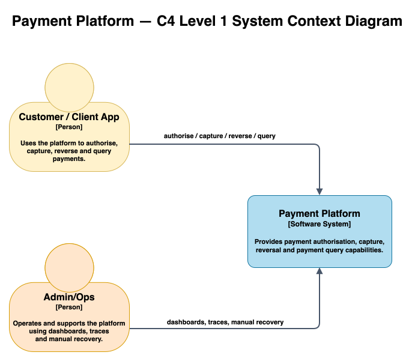

# System Context (C4 Level 1)

## Table of Contents

- [Diagram](#diagram)
- [What the platform does](#what-the-platform-does)
- [External actors / systems](#external-actors--systems)
- [System boundary and responsibilities](#system-boundary-and-responsibilities)
- [Next Phase (Planned)](#next-phase-planned)

## Diagram

  

*Figure 1: System Context — external actors and the platform boundary.*

## What the platform does

The Payment Platform is a distributed payment-processing system built around explicit service and data-ownership
boundaries. It supports authorise, capture, and reverse payment flows, combining synchronous fraud evaluation
with asynchronous ledger propagation through a transactional outbox and Kafka.

Payment mutations use idempotency and concurrency control for predictable behaviour under retries and competing
updates, while distributed tracing, metrics, dashboards, and correlated logs provide end-to-end visibility
across service boundaries.

## External actors / systems

At the current system boundary, the external actors are API clients interacting with payment capabilities and
operators responsible for observing and managing the platform. External payment-processor integration is part
of the planned next-phase architecture.

| Actor / System            | Type       | Interaction                                                                                                                                                                                                       |
|---------------------------|------------|-------------------------------------------------------------------------------------------------------------------------------------------------------------------------------------------------------------------|
| **Customer / Client App** | API client | Issues `authorise`, `capture`, and `reverse` requests and reads account/authorisation state. Current API interactions can be exercised through Swagger UI, Postman, and the project's traffic-generation scripts. |
| **Admin / Ops**           | Person     | Operates the platform: inspects dashboards, traces, Kafka topics, and databases; performs operational recovery actions such as outbox replay using the documented runbook.                                        |

## System boundary and responsibilities

At this level, the **Payment Platform** is represented as a single system boundary. Its internal distributed
architecture — `auth-service`, `fraud-service`, `ledger-service`, Kafka, Redis, PostgreSQL, and the observability
stack — is described at C4 Level 2 in [Containers](./containers.md).

As one system, the platform is responsible for:

- exposing account and payment lifecycle APIs for authorise, capture, and reverse operations
- evaluating fraud risk synchronously where an immediate authorisation decision is required, with timeout and
  circuit-breaker protection
  ([ADR 0008: Use Resilience4j for Circuit Breaker / Time Limiter (Fraud Gateway)](../decisions/0008-resilience4j-circuit-breaker-policy.md))
- enforcing idempotency and concurrency control on payment mutations so retries and competing updates have
  predictable outcomes
  ([ADR 0005: Idempotency and Concurrency Rules for Authorisation Flows](../decisions/0005-idempotency-and-concurrency.md) /
  [ADR 0007: Idempotency store and key policy](../decisions/0007-idempotency-store-and-key-policy.md))
- propagating payment state changes asynchronously through a transactional outbox and Kafka, allowing downstream
  ledger processing to remain independently coupled
  ([ADR 0001: Use Kafka + Transactional Outbox](../decisions/0001-use-kafka-outbox.md))
- maintaining an independent, queryable ledger projection from payment events, including read-only
  authorisation/account-event history
  ([ADR 0003: Store Both Raw and Normalized Ledger Events](../decisions/0003-ledger-raw-and-normalized-events.md))
- providing end-to-end operational visibility through distributed tracing, metrics, dashboards, and correlated
  logs

## Next Phase (Planned)

The next phase extends the existing distributed-system foundation with identity and access management, an API
gateway, reconciliation, notifications, external processor integration, and customer/admin applications.

See [Containers — Next Phase](./containers.md#next-phase-planned) for the planned container-level architecture
and the [project roadmap](../roadmap.md) for implementation sequencing and priorities.
