# Trust Boundaries

## Table of Contents

- [Diagram](#diagram)
- [Trust boundaries in the platform](#trust-boundaries-in-the-platform)
    - [1) Public API boundary (Client -> auth-service / ledger-service)](#1-public-api-boundary-client---auth-service--ledger-service)
    - [2) Internal service boundary (auth-service -> fraud-service)](#2-internal-service-boundary-auth-service---fraud-service)
    - [3) Service-owned data boundary](#3-service-owned-data-boundary)
    - [4) Asynchronous messaging boundary (Kafka: auth-service -> ledger-service)](#4-asynchronous-messaging-boundary-kafka-auth-service---ledger-service)
- [Identity and access evolution](#identity-and-access-evolution)
- [Sensitive data and propagation](#sensitive-data-and-propagation)
- [Related](#related)

## Diagram

Trust boundaries as a simplified data-flow diagram. Dashed boxes mark the application-level trust zones described below.

  

*Figure 5: Trust boundaries — the platform's security zones.*

This document describes the trust boundaries crossed by the Payment Platform across public APIs, service-to-service
communication, service-owned data, and asynchronous messaging.

The current architecture establishes explicit application and data-ownership boundaries, request validation,
payment-state controls, fraud evaluation, service isolation, reliable event delivery, and traceable cross-service
communication. Identity and access management, transport security, infrastructure authentication, and network-policy
controls are part of the planned next-phase and deployment architecture. Implementation sequencing and broader
deployment controls are tracked in the [roadmap](../roadmap.md).

## Trust boundaries in the platform

### 1) Public API boundary (Client -> auth-service / ledger-service)

- **Surface:** `auth-service` (`:9000`) and `ledger-service` (`:9020`) accept inbound HTTP requests from API clients.
- **Current controls:** bean validation rejects malformed input (`400`); idempotency and concurrency controls protect
  payment mutations from conflicting or duplicate processing; payment lifecycle rules enforce valid state transitions;
  every authorisation is evaluated for fraud risk before funds are reserved.
  See [ADR 0005: Idempotency and Concurrency Rules for Authorisation Flows](../decisions/0005-idempotency-and-concurrency.md)
  and [ADR 0007: Idempotency store and key policy](../decisions/0007-idempotency-store-and-key-policy.md).
- **Planned evolution:** the planned identity and access layer introduces authenticated customer and administrative
  identities, scoped authorization, and centralized ingress through the API Gateway.

### 2) Internal service boundary (auth-service -> fraud-service)

- **Surface:** `auth-service` calls `fraud-service` (`:9010`) over HTTP within the platform network.
- **Current controls:** `fraud-service` is an internal service boundary called synchronously by `auth-service`. The
  interaction is protected by a Resilience4j circuit breaker and time limiter, bounding the effect of fraud-service
  latency or unavailability on the authorisation path.
  See [ADR 0008: Use Resilience4j for Circuit Breaker / Time Limiter (Fraud Gateway)](../decisions/0008-resilience4j-circuit-breaker-policy.md).
- **Planned evolution:** service-to-service identity and transport protection, such as mTLS or signed internal-service
  credentials, form part of the deployment security architecture.

### 3) Service-owned data boundary

- **Surface:** three PostgreSQL databases (`auth_db`, `fraud_db`, `ledger_db`) hosted on the platform's PostgreSQL
  instance, plus Redis.
- **Data held per service:**
    - `account`: `available_balance`, `reserved_balance` (financial)
    - `authorisation` / `authorisation_event`: `amount`, `currency_code`, `merchant_reference` (financial)
    - `fraud_evaluation`: `amount`, `ip_address` (behavioral), `risk_score`, `decision`
    - `ledger_entry` / `ledger_event_log`: `amount`, projected `balance`, raw event payloads (financial, audit)
    - Redis: TTL-bounded cached idempotent HTTP responses and ephemeral fraud velocity counters
- **Current controls:** each application service owns and accesses only its own database. There is no cross-service
  schema access; data crosses service boundaries through explicit APIs and events. Redis is shared infrastructure, with
  `auth-service` and `fraud-service` using disjoint key namespaces for separate responsibilities.
  See [Containers](./containers.md).
- **Planned evolution:** encryption at rest and in transit, per-service least-privilege database identities, secret
  rotation, and network-policy controls extend the service-owned data boundary at deployment level.

### 4) Asynchronous messaging boundary (Kafka: auth-service -> ledger-service)

- **Surface:** `auth.events` and `auth.events.ledger.dlt` on the three-broker KRaft Kafka cluster.
- **Current controls:** payment events cross the auth-to-ledger service boundary using delivery and processing controls
  including `acks=all`, idempotent producer configuration, `read_committed` consumer isolation, retry/dead-letter
  routing, and ledger-side event deduplication through `processed_event`. Combined with the transactional outbox, this
  keeps asynchronous ledger propagation outside the originating database transaction while providing recoverable
  at-least-once delivery.
  See [ADR 0004: Use Separate Main Event and DLT Topics](../decisions/0004-use-event-and-dlt-topics.md)
  and [ADR 0003: Store Both Raw and Normalized Ledger Events](../decisions/0003-ledger-raw-and-normalized-events.md).
- **Planned evolution:** broker authentication, transport encryption, and topic-level authorization extend the messaging
  boundary at deployment level.

## Identity and access evolution

The current project focuses its implemented trust controls on service and data boundaries, request integrity,
payment-state correctness, fraud evaluation, failure isolation, and reliable event propagation.

The planned identity and access architecture extends that foundation with:

- authenticated customer and administrative identities through an Identity Provider
- authorization scopes separating customer and operational capabilities
- centralized ingress and policy enforcement through the API Gateway
- service-to-service identity for internal communication
- infrastructure-level access controls for PostgreSQL, Redis, Kafka, and operational tooling

These capabilities are represented in the planned next-phase architecture.
See [Containers — Next Phase](./containers.md#next-phase-planned) and the [project roadmap](../roadmap.md) for
implementation sequencing and priorities.

## Sensitive data and propagation

- **Correlation and diagnostic trail:** every request receives a correlation ID (`CorrelationIdFilter` in
  `shared-spring-lib`) that is propagated across HTTP calls and into Kafka headers, alongside W3C `traceparent` context
  for distributed tracing. Logs include `[traceId,spanId] [correlationId]`, providing a consistent diagnostic trail
  across synchronous and asynchronous service boundaries.
- **Idempotency data:** client-supplied idempotency keys are stored with TTL-bounded cached responses in Redis (default
  24h). Because those responses can contain payment-related data, the cache is treated as part of the platform's
  protected data boundary.
- **Account data ownership:** `auth-service` owns authoritative account balances in `auth_db`. `fraud-service` receives
  the request data required for risk evaluation, while `ledger-service` builds its own projection from published payment
  events rather than reading `auth-service` state directly.
- **Fraud data ownership:** `fraud-service` owns detailed fraud-evaluation data such as IP address, risk score,
  decision, and related evidence. The service boundary exposes the decision required by the authorisation workflow
  rather than sharing its internal fraud data model.
- **Transport and at-rest protection:** encryption and related infrastructure controls are part of the planned
  deployment architecture and are tracked in the [project roadmap](../roadmap.md).

## Related

- [System Context](./system-context.md)
- [Containers](./containers.md)
- [Components — auth-service](./components-auth-service.md)
- [Roadmap](../roadmap.md)
- [ADR 0006 — Redis sliding-window rate limiting](../decisions/0006-use-redis-for-sliding-window-fraud-velocity-checks.md)
- [ADR 0007 — Idempotency store and key policy](../decisions/0007-idempotency-store-and-key-policy.md)
- [API docs — Security](../api/README.md#security)
