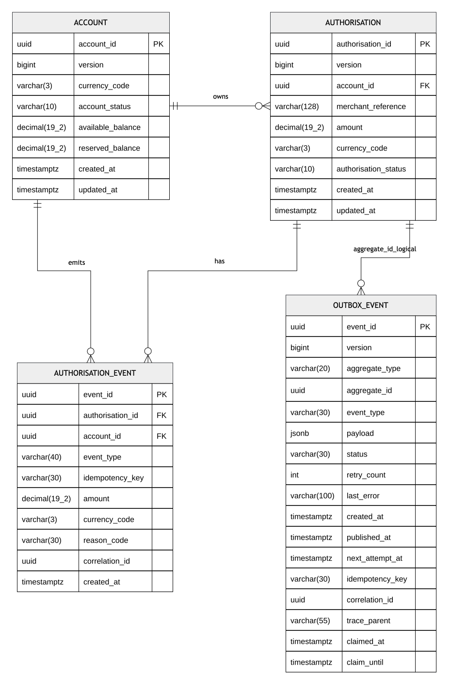
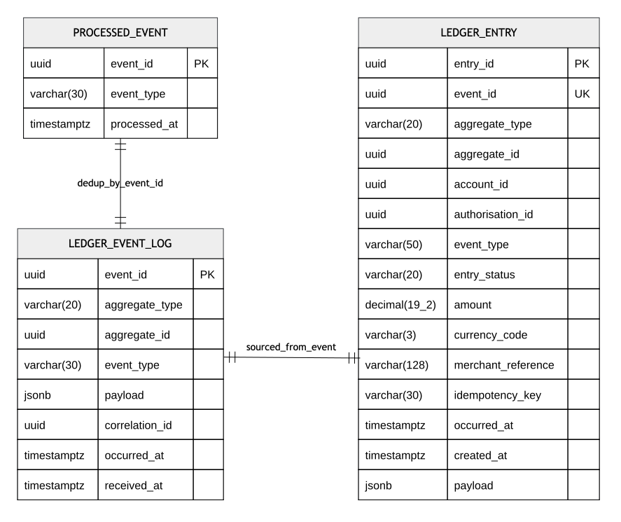
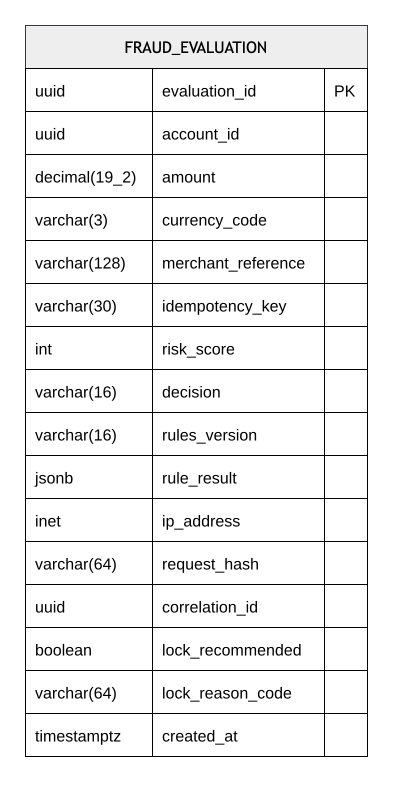

# Data Model Overview

## Table of Contents

- [Auth DB (auth-service)](#auth-db-auth-service)
- [Ledger DB (ledger-service)](#ledger-db-ledger-service)
- [Fraud DB (fraud-service)](#fraud-db-fraud-service)
- [End-to-end event reliability](#end-to-end-event-reliability)

This document summarises the core tables used by `auth-service`, `fraud-service`, and `ledger-service`. Each service
owns its persistence model; cross-service coordination takes place through explicit APIs and asynchronous events rather
than shared database access.

## Auth DB (auth-service)

### Auth ER Diagram

  

*Figure 1: Auth ER Diagram — `auth_db` tables.*

### Main tables

- `account`
    - Source of truth for account balances and account status.
    - `available_balance` and `reserved_balance` are updated through the authorise, capture, and reverse lifecycle.
      Authorisation reserves funds, capture finalises the reservation, and reversal releases reserved funds back to the
      available balance.

- `authorisation`
    - Stores current business state of each authorisation (`AUTHORISED`, `CAPTURED`, `REVERSED`, `DECLINED`).
    - Linked to `account` via `account_id`.

- `authorisation_event`
    - Durable domain-event history for authorisation lifecycle transitions.
    - Tracks `event_type`, `idempotency_key`, `reason_code`, and `correlation_id`.

### Event/outbox table purpose

- `outbox_event`
    - Transactional outbox for reliable asynchronous delivery to Kafka.
    - Event is written in the same transaction as business changes, then published by scheduler.
    - Stores `trace_parent` so async publisher spans can link back to the originating request trace.
    - Includes retry state (`status`, `retry_count`, `next_attempt_at`, `last_error`) and claim lease fields (
      `claimed_at`, `claim_until`).

### Idempotency strategy

- **Response cache:** Redis stores completed idempotent responses for a TTL-bounded fast path; the cache is not the
  durable source of truth.
- **Request-level checks:** existing `authorisation` state and request-payload equality are checked to recognise replays
  and detect conflicting reuse of an idempotency key.
- **Durable event-level guard:** `authorisation_event` has the unique constraint
  `uq_authorisation_event_account_eventtype_idempotency` on `(account_id, event_type, idempotency_key)`, protecting
  against duplicate lifecycle-event processing for the same scope and operation.
- **Additional schema uniqueness:** `(account_id, idempotency_key, created_at)` is also documented in the schema.
  Because `created_at` is part of this key, this constraint does not by itself prevent reuse of an idempotency key at a
  different timestamp; replay and conflict behaviour relies on the request checks and operation-scoped guard above.

## Ledger DB (ledger-service)

### Ledger ER Diagram

  

*Figure 2: Ledger ER Diagram — `ledger_entry`, `ledger_event_log`, and `processed_event` tables and their
relationships in `ledger_db`.*

### Main tables

- `ledger_entry`
    - Read-optimised projection used by query APIs.
    - Stores the current immutable accounting entries derived from consumed events.
    - `merchant_reference` supports up to 128 chars; `event_type` supports up to 50 chars.

- `ledger_event_log`
    - Immutable event audit log of consumed Kafka events.
    - Preserves original payload and correlation metadata for tracing/debugging.

### Idempotency strategy

- `processed_event`
    - Consumer-side deduplication table keyed by `event_id`.
    - An insert-once guard (`ON CONFLICT DO NOTHING`) identifies repeated deliveries of the same event ID.
- Handler flow:
    - If the `processed_event` insert succeeds, persist the corresponding `ledger_event_log` and `ledger_entry` records.
    - If the event ID has already been recorded, skip duplicate projection.
- **Transaction boundary:** the deduplication marker and ledger writes should commit together to prevent a recorded
  event from being skipped after a partial projection failure. Confirm this shared transaction boundary against the
  consumer implementation.

## Fraud DB (fraud-service)

### Fraud ER Diagram

  

*Figure 3: Fraud ER Diagram — the `fraud_evaluation` table and its fields in `fraud_db`.*

### Main tables

- `fraud_evaluation`
    - Durable record for one fraud evaluation per `(account_id, idempotency_key)` request.
    - Stores request fingerprint (`request_hash`), risk outcome (`risk_score`, `decision`), and detailed rule output (
      `rule_result`).
    - Persists account-lock recommendation signals via `lock_recommended` and `lock_reason_code`.

### Idempotency strategy

- `fraud_evaluation`
    - Unique index `uq_fraud_evaluation_account_idempotency` on `(account_id, idempotency_key)` ensures deduplication
      per account.
    - The service first claims a request with a `PENDING` row, then finalises the same row with score/decision to handle
      concurrent duplicates safely.

## End-to-end event reliability

The platform combines a transactional outbox with consumer-side deduplication to support reliable, **at-least-once**
event propagation.

- **Producer side:** `auth-service` commits payment-state changes and the corresponding `outbox_event` record in the
  same database transaction. A background publisher sends committed events to Kafka and uses retry and recovery
  mechanisms when publication fails.
- **Messaging:** Kafka decouples payment processing from downstream ledger updates. Duplicate publication or delivery
  remains possible, including during retries and recovery.
- **Consumer side:** `ledger-service` uses `processed_event`, keyed by `event_id`, to identify previously handled events
  and avoid duplicate ledger projections. The transaction boundary described above is important to this guarantee.
- **Consistency model:** payment state is committed locally in `auth_db`; ledger projections are updated asynchronously,
  giving strong local transaction consistency and eventual consistency across service boundaries.
