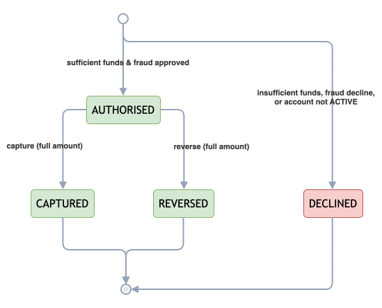
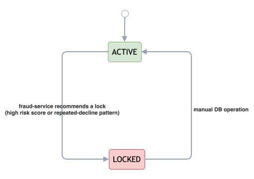

# Payment State Machine

## Table of Contents

- [Diagram](#diagram)
    - [Authorisation state machine](#authorisation-state-machine)
    - [Account lock state machine](#account-lock-state-machine)
- [Aggregates](#aggregates)
- [States](#states)
    - [Authorisation states (implemented)](#authorisation-states-implemented)
    - [Account states (implemented)](#account-states-implemented)
    - [Planned states (future scope)](#planned-states-future-scope)
- [Allowed Transitions](#allowed-transitions)
    - [Account-level transition (parallel state machine)](#account-level-transition-parallel-state-machine)
- [Guards / Preconditions](#guards--preconditions)
- [Terminal States](#terminal-states)
- [Concurrency / Idempotency Behaviour](#concurrency--idempotency-behaviour)
- [Error Mapping](#error-mapping)
- [Related](#related)

## Diagram

### Authorisation state machine

  

*Figure 1: Payment authorisation state machine.*

### Account lock state machine

  

*Figure 2: Account lock state machine — fraud-service signals can trigger `ACTIVE` → `LOCKED`; returning to `ACTIVE`
currently requires manual intervention.*

## Aggregates

Two independent state machines govern payment behaviour:

1. **Authorisation** — the payment/transaction lifecycle (`AuthorisationStatus`, `auth-service`). This is the primary
   aggregate this document focuses on.
2. **Account** — a coarser-grained fraud-response gate (`AccountStatus`, `auth-service`) that runs alongside, not
   instead of, the authorisation state machine.

There is no separate "reservation" aggregate — the reservation concept is modelled as a pair of balance fields (
`availableBalance`, `reservedBalance`) on the account, mutated as a side effect of authorisation state transitions, not
as its own state machine.

## States

### Authorisation states (implemented)

| State        | Meaning                                                                                                             | Terminal? |
|--------------|---------------------------------------------------------------------------------------------------------------------|-----------|
| `AUTHORISED` | Funds reserved; can be captured or reversed                                                                         | No        |
| `CAPTURED`   | Reserved funds settled/consumed                                                                                     | Yes       |
| `REVERSED`   | Reserved funds released back to available balance                                                                   | Yes       |
| `DECLINED`   | Authorisation rejected (fraud decline or insufficient funds); reached directly at creation, never from `AUTHORISED` | Yes       |

> There is no persisted `RECEIVED` state — the decision to become `AUTHORISED` or `DECLINED` is made synchronously
> within the same request/transaction that creates the authorisation record.

### Account states (implemented)

| State    | Meaning                                                                                                                                                                                                                                           |
|----------|---------------------------------------------------------------------------------------------------------------------------------------------------------------------------------------------------------------------------------------------------|
| `ACTIVE` | Normal operation; deposits, reservations, captures, reversals permitted                                                                                                                                                                           |
| `LOCKED` | Fraud-triggered lock; new authorisation requests are declined (persisted as `DECLINED`, reason `ACCOUNT_LOCKED`) before fraud-service is even called — the request is not rejected outright, but the account is never debited or reserved against |

An automated or API-driven path back from `LOCKED` to `ACTIVE` is planned; unlocking is a manual DB
operation today (tracked on the roadmap, not silently omitted).

### Planned states (future scope)

Per [ADR 0002: Support Full Capture and Full Reverse Only (MVP)](../decisions/0002-full-capture-only.md), the
following are explicitly out of scope for the MVP and are **not** real states today. They are listed here only so
future work has a documented target, and are tracked in [Payment Platform MVP Progress](../roadmap.md):

- `PARTIALLY_CAPTURED` — would require splitting a reservation across multiple captures
- `EXPIRED` — would require a time-boxed authorisation hold with an expiry sweep
- `REFUNDED` — would require a post-capture money-movement flow (refunds are out of scope; only pre-capture
  reverse/release exists)

## Allowed Transitions

| From         | Event/Command                                                                                                                 | To           | Notes                                                                                         |
|--------------|-------------------------------------------------------------------------------------------------------------------------------|--------------|-----------------------------------------------------------------------------------------------|
| *(none)*     | `POST /authorisations` — fraud approved, sufficient funds                                                                     | `AUTHORISED` | Funds reserved: `availableBalance -= amount`, `reservedBalance += amount`                     |
| *(none)*     | `POST /authorisations` — fraud declined, insufficient funds, account not `ACTIVE`, or fraud-service unavailable (fail-closed) | `DECLINED`   | No balance effect; account itself is untouched                                                |
| `AUTHORISED` | `POST /authorisations/{id}/captures`                                                                                          | `CAPTURED`   | Full amount only: `reservedBalance -= amount` (funds do **not** return to `availableBalance`) |
| `AUTHORISED` | `POST /authorisations/{id}/reversals`                                                                                         | `REVERSED`   | Full amount only: `reservedBalance -= amount`, `availableBalance += amount`                   |
| `CAPTURED`   | *(any)*                                                                                                                       | —            | Terminal; no further transitions possible                                                     |
| `REVERSED`   | *(any)*                                                                                                                       | —            | Terminal; no further transitions possible                                                     |
| `DECLINED`   | *(any)*                                                                                                                       | —            | Terminal; no further transitions possible                                                     |

Any capture or reverse request against an authorisation **not** currently `AUTHORISED` is rejected as an invalid
transition — **except** when it is a same-idempotency-key replay of an operation that already completed (see
Concurrency/Idempotency Behaviour below).

### Account-level transition (parallel state machine)

| From     | Event/Command                                                                                                  | To       | Notes                                                                      |
|----------|----------------------------------------------------------------------------------------------------------------|----------|----------------------------------------------------------------------------|
| `ACTIVE` | Fraud-service recommends a lock (very high risk score, or a repeated-decline pattern within a trailing window) | `LOCKED` | Applied in the same transaction as the triggering `DECLINED` authorisation |

## Guards / Preconditions

These conditions are evaluated before a transition is allowed to proceed:

| Guard                                                  | Applies to                  | Effect if failed                                                                                                                                                                                               |
|--------------------------------------------------------|-----------------------------|----------------------------------------------------------------------------------------------------------------------------------------------------------------------------------------------------------------|
| Account is `ACTIVE`                                    | Authorise                   | Declined immediately (`ACCOUNT_LOCKED` / `ACCOUNT_INACTIVE`) — fraud-service is not even called                                                                                                                |
| Fraud decision is `APPROVE`                            | Authorise                   | Declined (`FRAUD_DECLINED`) — no balance effect                                                                                                                                                                |
| Sufficient `availableBalance`                          | Authorise                   | Declined (`INSUFFICIENT_FUNDS`) — authorisation is still persisted as `DECLINED`, account untouched                                                                                                            |
| Currency of request matches account currency           | Authorise                   | Rejected with `CurrencyMismatchException` before any reservation is attempted                                                                                                                                  |
| Authorisation currently `AUTHORISED`                   | Capture, Reverse            | Rejected as `INVALID_AUTHORISATION_STATE` (`409`), unless it's a same-key replay of a completed operation                                                                                                      |
| Idempotency key consistency (same key -> same payload) | Authorise, Capture, Reverse | Same key + same payload replays prior response; same key + different payload rejected as `IDEMPOTENCY_CONFLICT` (`409`)                                                                                        |
| Timeout window                                         | Fraud-service call          | A 500 ms Resilience4j TimeLimiter and circuit breaker protect the synchronous fraud-service dependency. If fraud evaluation becomes unavailable, the authorisation flow applies its configured fallback policy |

An `AUTHORISED` hold has no time-boxed expiry today — it stays open until captured or reversed, which keeps the state
machine simple and predictable for this platform's scope.

## Terminal States

`CAPTURED`, `REVERSED`, and `DECLINED` are all terminal. Once an authorisation reaches one of these states:

- No further capture or reverse operation is accepted (other than an idempotent replay of the same operation that
  produced the terminal state).
- The only "operation" still valid against a terminal-state authorisation is a safe retry with the exact same
  idempotency key and payload that already produced that state.

## Concurrency / Idempotency Behaviour

- **Idempotency scope:** The database enforces uniqueness on `(account_id, event_type, idempotency_key)` for
  authorisation events — for authorise, capture, and reverse alike. Redis response-cache keys additionally scope
  capture and reverse operations by `authorisationId` (
  see [ADR 0005: Idempotency and Concurrency Rules for Authorisation Flows](../decisions/0005-idempotency-and-concurrency.md)
  and [ADR 0007: Idempotency Store Strategy and Key Policy (Auth/Fraud)](../decisions/0007-idempotency-store-and-key-policy.md)
  for the distinction).
- **Duplicate request, same payload:** returns the previously computed response; no new side effect (no second
  reservation, capture, or reversal).
- **Duplicate request, different payload, same key:** rejected with `409 IDEMPOTENCY_CONFLICT`.
- **Same-key race:** concurrent requests using the same idempotency key may encounter a database uniqueness conflict (
  `uq_authorisation_event_account_eventtype_idempotency`). The losing request can recover by checking the committed
  operation and replaying its response if the semantic payload matches; otherwise, it returns an idempotency conflict
  (`409 IDEMPOTENCY_CONFLICT`).
- **Different-key race:** concurrent operations using different idempotency keys may conflict when updating the same
  account. Optimistic locking detects conflicting writes, and the losing request receives an account concurrency
  conflict (`409 ACCOUNT_CONCURRENCY_CONFLICT`) rather than another operation's response (
  see [ADR 0010: Database Concurrency Approach (Optimistic vs Pessimistic Locking)](../decisions/0010-database-concurrency-approach.md)).
- **Kafka delivery (ledger-service side):** at-least-once delivery is handled by deduplicating on `eventId` via
  `processed_event` (atomic `INSERT ... ON CONFLICT DO NOTHING`); a duplicate event is skipped, not reprocessed.

## Error Mapping

| Domain condition                                            | Exception                                                     |                               HTTP status | Error code                                      |
|-------------------------------------------------------------|---------------------------------------------------------------|------------------------------------------:|-------------------------------------------------|
| Authorisation not in the required state for capture/reverse | `AuthorisationIllegalStateException`                          |                                       409 | `INVALID_AUTHORISATION_STATE`                   |
| Same idempotency key, different payload                     | `IdempotencyConflictException`                                |                                       409 | `IDEMPOTENCY_CONFLICT`                          |
| Concurrent request lost the race on the same account        | `AccountConcurrencyConflictException`                         |                                       409 | `ACCOUNT_CONCURRENCY_CONFLICT`                  |
| Insufficient available balance                              | — (persisted as `DECLINED`)                                   | 200 (business decline, not an HTTP error) | `INSUFFICIENT_FUNDS` (as `reason`)              |
| Currency of request does not match account                  | `CurrencyMismatchException`                                   |                                       409 | `CURRENCY_MISMATCH`                             |
| Account or authorisation does not exist                     | `AccountNotFoundException` / `AuthorisationNotFoundException` |                                       404 | `ACCOUNT_NOT_FOUND` / `AUTHORISATION_NOT_FOUND` |
| Malformed/invalid request payload                           | Bean validation failure                                       |                                       400 | —                                               |

Note the distinction between a **business decline** (insufficient funds, fraud decline — a valid, successful API
response describing a business outcome) and a **domain/state error** (invalid transition, idempotency conflict — an
actual `409`/`400` error response). Declines are not errors; they are a normal terminal state of the authorisation flow.

## Related

- [Accounting Model](./accounting-model.md) — how these state transitions map to ledger postings
- [Payment Lifecycle](../flows/payment-lifecycle.md) — full request-level walkthrough of each flow
- [ADR 0002: Support Full Capture and Full Reverse Only (MVP)](../decisions/0002-full-capture-only.md) — why
  partial capture/reverse/refund are out of scope
- [ADR 0005: Idempotency and Concurrency Rules for Authorisation Flows](../decisions/0005-idempotency-and-concurrency.md)
  — idempotency and concurrency rules
- [ADR 0010: Database Concurrency Approach (Optimistic vs Pessimistic Locking)](../decisions/0010-database-concurrency-approach.md)
  — optimistic locking approach
- [Payment Platform MVP Progress](../roadmap.md) — planned states (partial capture, expiry, refund) and account
  unlock flow

